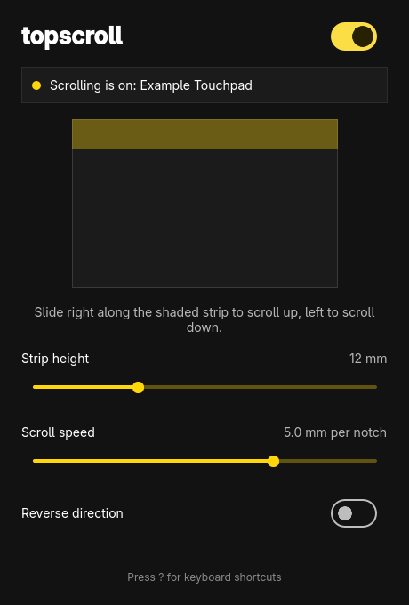
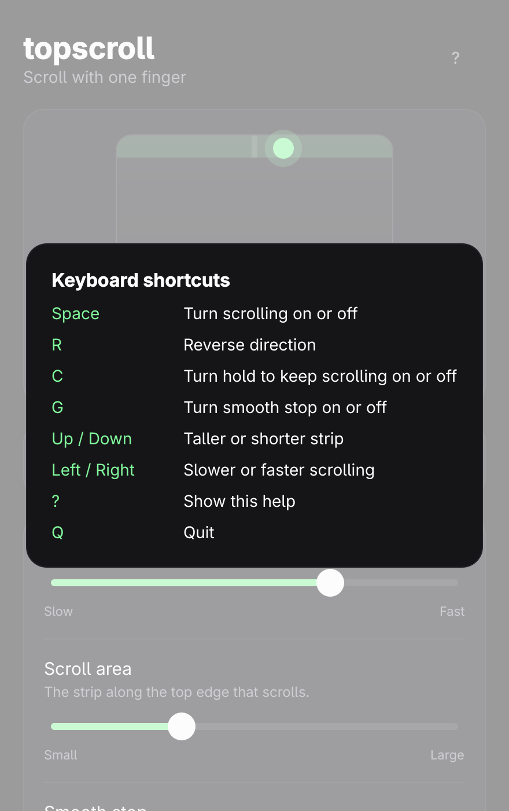

<div align="center">

# topscroll

**Scroll with one finger, along the top edge of your touchpad.**
Slide right to scroll up, slide left to scroll down. Everything else on the touchpad (cursor, taps, clicks, gestures) works exactly as before. Made for [Omarchy](https://omarchy.org).





</div>

---

## Highlights

- **One finger is enough.** Put a finger down in the strip along the top edge and slide. It scrolls like a mouse wheel, in every app, on Wayland and X11.
- **Optional cruise mode.** Turn on Cruise and a finger resting on the strip keeps scrolling, faster the further you slide. Lift to stop.
- **Nothing else changes.** A touch that starts anywhere else is passed through untouched, and so are clicks and multi-finger gestures. A second finger never gets captured by the strip.
- **See what you are tuning.** The settings window draws your touchpad to scale with the strip shaded, and every change applies instantly.
- **Runs in the background.** A small systemd user service does the work, so scrolling survives closing the window and comes back at every login. It finds the touchpad again after a replug or resume.
- **Feels like part of Omarchy.** It follows the theme's accent colour and your corner rounding live, and speaks the language chosen in Setup > Language.
- **Private by design.** No network code, no logging, no analytics. Touch events are only read to route them.

## Installing

topscroll is not in the Omarchy package repository yet, so build the package yourself. You need `git`, `base-devel` and the Qt 6 packages that ship with Omarchy.

```bash
git clone https://github.com/BallbeIan/topscroll.git
cd topscroll
bin/install        # makepkg -fsi: builds the package and installs it
```

Then open **topscroll** from the launcher (`Super + Space`) and press **Start**. That enables the user service. From then on sliding along the top edge scrolls.

To remove it:

```bash
systemctl --user disable --now topscroll
sudo pacman -R topscroll
```

## Using it

| Setting | What it does |
|---|---|
| **On / off** | Lets go of the touchpad entirely when off, so it behaves as if topscroll weren't installed. |
| **Strip height** | How far down from the top edge the scroll strip reaches (4 to 30 mm, 12 by default). |
| **Scroll speed** | How far your finger travels per wheel notch (2 to 12 mm, 5 by default). |
| **Reverse direction** | Right scrolls down instead of up. |
| **Cruise** | Off by default. Keep your finger down and it keeps scrolling, with no need to keep moving it. The further you slide from where you touched down, the faster it goes. Slide back toward the start to slow down, past it to reverse, and lift your finger to stop. Small movements (under 4 mm) never start it, and the speed is capped at 60 notches per second. The **Scroll speed** setting scales it. |

Settings are saved as you change them to `~/.config/topscroll/topscroll.conf`, and the service picks them up immediately.

### Keyboard shortcuts

| Key | Action |
|---|---|
| `Space` | Turn scrolling on or off |
| `R` | Reverse direction |
| `C` | Turn cruise on or off |
| `Up` / `Down` | Taller or shorter strip |
| `Left` / `Right` | Slower or faster scrolling |
| `?` | Show shortcuts |
| `Q` | Quit |

### Command line

```bash
topscroll              # the settings window (same as `topscroll open`)
topscroll daemon       # run the scrolling service in the foreground
topscroll status       # what the service is doing; add --json for scripts, exits 1 if it isn't running
```

## Requirements and compatibility

- Linux with **evdev and uinput**, **systemd**, and **Qt 6.5 or newer**.
- Developed on an **Omarchy** laptop (Hyprland, Wayland). Other touchpads and desktops have not been verified yet. If you try it on one, please [open an issue](../../issues/new/choose) and say what worked.
- Only the first detected touchpad is handled.
- Compositor settings that are keyed on the touchpad's name do not apply to the virtual touchpad, which is named `<touchpad name> (topscroll)`. Global touchpad settings still apply.

## Permissions

| What | Why |
|---|---|
| Read access to your touchpad's `/dev/input/event*` node | To see touches. A udev rule gives the logged-in user access through logind's `uaccess` tag, so you do not need to join the `input` group. |
| `/dev/uinput` | To re-emit touches through a virtual touchpad and to create the virtual wheel. The same udev rule grants it, and the `uinput` module is loaded at boot. |

Access to `/dev/uinput` means any program you run can create virtual input devices, including a virtual keyboard. That is the same trade-off other packages make, such as game-controller remappers. If you are not comfortable with it, do not install topscroll.

The package installs these files: the `topscroll` binary, a desktop entry and icon, `70-topscroll.rules`, a `modules-load.d` entry and the user service. See [`pkgbuild/`](pkgbuild).

## How it works

libinput has no top-edge scrolling, so the daemon grabs the touchpad through evdev and re-emits every touch through a virtual touchpad. A touch that *starts* in the top strip while no other finger is down is swallowed, so the cursor does not move, and its horizontal motion becomes wheel events on a virtual mouse. It works on Wayland and X11 because it sits below the compositor.

```
 touchpad ──► Daemon ──► Scroller ──┬──► virtual touchpad   (every other touch, clicks, gestures)
 (grabbed)      ▲                   └──► virtual wheel      (touches that began in the strip)
                │
 topscroll.conf ┘   settings window ──► topscroll.conf       daemon ──► status.json ──► settings window
```

The settings window only edits `topscroll.conf`, and the daemon watches that file. The daemon reports what it is doing in `$XDG_RUNTIME_DIR/topscroll/status.json`, which the window and `topscroll status` read.

| Path | What it does |
|---|---|
| `src/scroller.{h,cpp}` | The routing logic. Writes to an `EventSink`, so tests need no hardware |
| `src/evdev.{h,cpp}` | Reads touchpad capabilities and creates virtual devices through `/dev/uinput` |
| `src/daemon.{h,cpp}` | Finds and grabs the touchpad, follows the config file, publishes status |
| `src/config.*`, `src/status.*` | The settings file and the status file |
| `src/backend.*`, `src/Main.qml` | The settings window |
| `src/theme.*`, `src/translator.*`, `src/i18n/` | Omarchy theme and language, followed live |
| `pkgbuild/` | PKGBUILD, desktop entry, icon, udev rule, user service |
| `tests/` | Qt Test suite |

## Building from source

You need `qmake6`, `make`, a C++20 compiler and Qt 6 base and declarative. On Omarchy:

```bash
omarchy-pkg-add base-devel qt6-base qt6-declarative qt6-wayland
```

```bash
git clone https://github.com/BallbeIan/topscroll.git
cd topscroll
bin/build          # qmake6 + make into build/topscroll
bin/test           # Qt Test suite, offscreen, never touches real input devices
```

When trying `build/topscroll daemon` by hand, point `XDG_CONFIG_HOME` and `XDG_RUNTIME_DIR` at a throwaway directory so it does not touch your real settings.

## Translations

English, Danish, German, Spanish and French so far. Other languages show English. Translations are small JSON files in [`src/i18n/`](src/i18n) (English text to translation), so adding a language is one file plus a line in `src/resources.qrc`.

## Roadmap

- [ ] Inertia: let scrolling glide to a stop after lifting
- [ ] Horizontal scrolling option
- [ ] A release tarball and an `omarchy-pkgs` entry

## Contributing

Bug reports and device reports are very welcome. See [CONTRIBUTING.md](CONTRIBUTING.md).

## License

[MIT](LICENSE)
