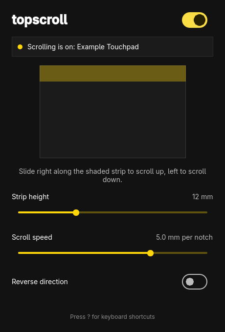
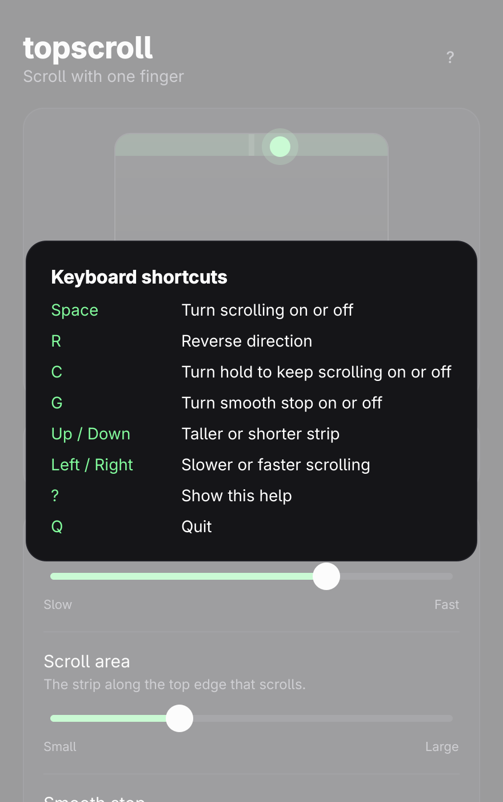

<div align="center">

# topscroll

**Scroll with one finger.**
Slide along the top edge of your laptop's touchpad to scroll, in any app. Everything else on the touchpad works exactly as before.




</div>

---

## What it does

Put one finger on the **top edge** of your touchpad and slide.

- Slide **right** to scroll **up**.
- Slide **left** to scroll **down**.

That's it. No second finger, no keyboard shortcut. Moving the cursor, tapping, clicking and multi-finger gestures all work the way they always did, because only touches that start on that top strip are treated as scrolling.

## Nice touches

- **Smooth stop.** Lift your finger mid-slide and the scrolling coasts on and eases out, like flicking a wheel.
- **Hold to keep scrolling.** Optional. Keep your finger down and it keeps going, faster the further you slide. Small accidental movements are ignored.
- **Make it yours.** Change the speed, the size of the strip and the direction, and watch the preview react. Every change applies instantly.
- **Always on.** It runs quietly in the background and comes back every time you log in. Closing the window doesn't stop it.
- **Private.** No network access, no logging, no analytics.

## Install

### Windows

1. Download **`topscroll-…-windows-x64-setup.exe`** from the [latest release](../../releases/latest) and run it. It installs just for you, so no administrator password is needed.
2. topscroll opens when the installer finishes, and from then on it starts by itself every time you sign in.
3. Slide a finger along the top edge of your touchpad.

Prefer not to install? The `windows-x64.zip` on the same page is portable: unzip it anywhere, run `topscroll.exe` and press **Start**.

Your laptop needs a **Precision Touchpad**, which almost every Windows 10 and 11 laptop has. You can check under *Settings > Bluetooth & devices > Touchpad*: if you see gesture settings there, you're good.

<details>
<summary>Uninstall (Windows)</summary>

*Settings > Apps > Installed apps > topscroll > Uninstall.* For the zip, run `topscroll.exe` once, turn it off, delete the folder, and remove `topscroll` from *Task Manager > Startup apps* if you pressed Start.

</details>

### Linux (Omarchy)

topscroll is made for [Omarchy](https://omarchy.org) and isn't in its package list yet, so you build the package once. You'll need `git` and `base-devel`; the Qt libraries it needs come with Omarchy.

```bash
git clone https://github.com/BallbeIan/topscroll.git
cd topscroll
bin/install
```

It will ask for your password to install the package. Then:

1. Open **topscroll** from the app launcher (`Super + Space`).
2. Press **Start** if it asks you to.
3. Slide a finger along the top edge of your touchpad.

If it says **Needs permission**, log out and back in once and try again.

<details>
<summary>Uninstall</summary>

```bash
systemctl --user disable --now topscroll
sudo pacman -R topscroll
```

</details>

## Using it

Everything is in the window. The sliders and switches do what they say:

| Setting | What it does |
|---|---|
| **On / off switch** | Turns scrolling off completely, so your touchpad behaves as if topscroll weren't installed. |
| **Speed** | How far you slide for each scroll step, from slow to fast. |
| **Scroll area** | How tall the scrolling strip along the top edge is. |
| **Smooth stop** | Keep coasting after you lift your finger, then ease to a stop. |
| **Hold to keep scrolling** | Keep your finger down and it keeps scrolling. The further you slide from where you started, the faster it goes. |
| **Flip direction** | Slide right to scroll down instead of up. |
| **Fine-tune** | Opens the finer controls: how long the smooth stop lasts, how much movement is ignored, and the start and top speed for holding to keep scrolling. **Reset to defaults** is in here too. |

Press `?` in the window for keyboard shortcuts.

<div align="center">

</div>

## Good to know

- **It's new.** topscroll was built and tested on one Omarchy laptop. Other touchpads and desktops should work but haven't been verified. If you try it, please [tell me how it went](../../issues/new/choose), even if everything works.
- **One touchpad.** Only the first touchpad it finds is used.
- **Permissions.** To see your touches and create a virtual touchpad, topscroll gets access to your touchpad and to `/dev/uinput`, which the package sets up for you. Any program you run can use `/dev/uinput` to create virtual input devices, including a virtual keyboard; other packages such as game-controller remappers make the same trade-off. If that's not for you, don't install topscroll.
- **On Windows.** Windows still sees your finger on the strip; topscroll holds the cursor still and blocks the tap while a strip touch is down, then sends ordinary mouse-wheel scrolling. Windows doesn't let normal programs scroll windows that run as administrator, so those won't scroll with topscroll.
- **Name-based settings (Linux).** The virtual touchpad is named `<your touchpad> (topscroll)`, so desktop settings keyed on the touchpad's exact name won't apply to it. General touchpad settings still do.

## Something not working?

| You see | Try this |
|---|---|
| **Needs permission** | Log out and back in, then open topscroll again. |
| **Can't start** | Log out and back in, or run `sudo modprobe uinput`. |
| **Touchpad in use** | Another program has taken over the touchpad. Close it and try again. |
| **Not running** | Press **Start**. |
| **Update ready** | Press **Restart** to start using the new version. |
| **Looking for a touchpad...** (Windows) | topscroll needs a Precision Touchpad. Check *Settings > Bluetooth & devices > Touchpad*; updating the touchpad driver from your laptop maker sometimes enables it. |
| Scrolls the wrong way | Turn on **Flip direction**. |

Still stuck? [Open an issue](../../issues/new/choose) and include the output of `topscroll status --json`.

## For developers

How it works, the code layout, building from source and adding a translation are in [docs/DEVELOPING.md](docs/DEVELOPING.md). Contributions are welcome; see [CONTRIBUTING.md](CONTRIBUTING.md). Command line: `topscroll` opens the window, `topscroll daemon` runs the service in the foreground, and `topscroll status` reports what the service is doing.

Available in English, Danish, German, Spanish and French.

## License

[MIT](LICENSE)
