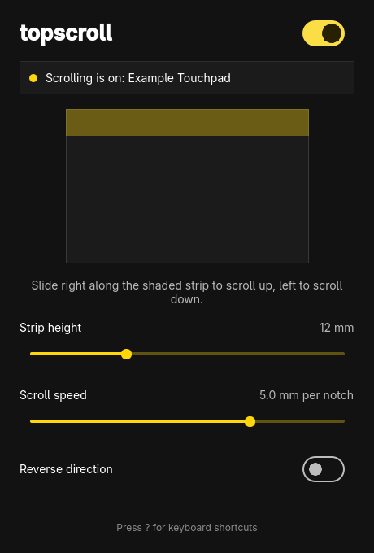

# topscroll



Scroll with **one finger** on a Linux laptop touchpad by sliding along its **top edge**, made for
[Omarchy](https://omarchy.org).

- Slide **right** along the top edge: scroll **up**
- Slide **left** along the top edge: scroll **down**

The rest of the touchpad (cursor, taps, clicks, multi-finger gestures) keeps working as normal.

## Install

```sh
bin/install     # builds the package with makepkg and installs it
```

Then open **topscroll** from the launcher (`Super + Space`) and press **Start**. That enables a
systemd user service, so scrolling comes back on every login. Close the window whenever you like;
the service keeps running.

## How it works

libinput has no top-edge scrolling, so `topscroll daemon` grabs the touchpad through evdev and
re-emits every touch through a virtual touchpad. A touch that *starts* in the top strip while no
other finger is down is swallowed (the cursor doesn't move) and its horizontal motion becomes wheel
events on a virtual mouse. It works on Wayland and X11 because it sits below the compositor.

The settings window only edits `~/.config/topscroll/topscroll.conf`; the daemon watches that file
and applies changes immediately. The daemon reports what it is doing in
`$XDG_RUNTIME_DIR/topscroll/status.json`.

## Permissions

The package installs a udev rule (`70-topscroll.rules`) that gives the logged-in user access to
touchpads and to `/dev/uinput` through logind's `uaccess` tag, and loads the `uinput` module at
boot. No `input` group needed.

Be aware that access to `/dev/uinput` lets any program you run create virtual input devices
(including a virtual keyboard). That is the same trade-off other packages such as game-controller
remappers make; if you don't want it, don't install this package.

## Keyboard shortcuts

| Key | Action |
| --- | --- |
| `Space` | Turn scrolling on or off |
| `R` | Reverse direction |
| `Up` / `Down` | Taller or shorter strip |
| `Left` / `Right` | Slower or faster scrolling |
| `?` | Show shortcuts |
| `Q` | Quit |

## Command line

```sh
topscroll              # settings window (same as `topscroll open`)
topscroll daemon       # run the scrolling service in the foreground
topscroll status       # what the service is doing; add --json for scripts. Exits 1 if it isn't running
```

## Develop

```sh
bin/build              # qmake6 + make into build/topscroll
bin/test               # Qt Test suite, offscreen, never touches real input devices
```

The scrolling logic (`src/scroller.cpp`) writes to an `EventSink`, so the tests drive it with
synthetic touches. Use a throwaway `XDG_CONFIG_HOME` and `XDG_RUNTIME_DIR` when trying
`build/topscroll daemon` so it doesn't touch your real settings.

## Known limitations

- Per-device compositor settings keyed on the touchpad's name won't apply to the virtual device,
  which is named `<touchpad name> (topscroll)`. Global touchpad settings still apply.
- Only the first detected touchpad is handled.
- Translations: English, Danish, German, Spanish and French so far. Other languages show English.

## Roadmap

- [ ] Scroll acceleration and inertia
- [ ] Horizontal scrolling option
- [ ] Release tarball and `omarchy-pkgs` entry

## License

MIT
